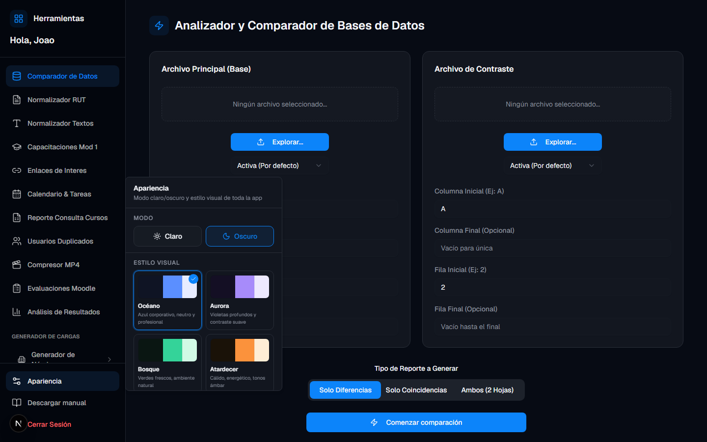

# Manual de usuario — Plataforma de Herramientas LMS

**Para uso diario en el navegador**  
**Empresa:** MAS Consultores / BEX y clientes  
**Idioma:** Español  
**Última actualización:** Noviembre 2026

---

## Tabla de contenidos

1. [¿Qué es esta plataforma?](#1-qué-es-esta-plataforma)
2. [Antes de empezar](#2-antes-de-empezar)
3. [Entrar a la plataforma](#3-entrar-a-la-plataforma)
4. [Conocer la pantalla principal](#4-conocer-la-pantalla-principal)
5. [Comparador de Datos](#5-comparador-de-datos)
6. [Normalizador RUT](#6-normalizador-rut)
7. [Normalizador de Textos](#7-normalizador-de-textos)
8. [Capacitaciones Mod 1](#8-capacitaciones-mod-1)
9. [Enlaces de interés](#9-enlaces-de-interés)
10. [Calendario y tareas](#10-calendario-y-tareas)
11. [Reporte Consulta Cursos](#11-reporte-consulta-cursos)
12. [Usuarios Duplicados](#12-usuarios-duplicados)
13. [Compresor MP4](#13-compresor-mp4)
14. [Evaluaciones Moodle](#14-evaluaciones-moodle)
15. [Análisis de Resultados](#15-análisis-de-resultados)
16. [Generador de Nóminas / Cargas](#16-generador-de-nóminas--cargas)
17. [Administración de usuarios](#17-administración-de-usuarios)
18. [Cambiar contraseña](#18-cambiar-contraseña)
19. [Preguntas frecuentes](#19-preguntas-frecuentes)
20. [¿Necesitas ayuda?](#20-necesitas-ayuda)

---

## 1. ¿Qué es esta plataforma?

Sitio web interno para tareas de capacitación y LMS **sin instalar programas**. Se usa desde Chrome, Edge o Firefox.

### Mapa de herramientas

| Menú | Para qué sirve |
|------|----------------|
| **Comparador de Datos** | Compara dos Excel y descarga un reporte |
| **Normalizador RUT** | Unifica formato de RUT chilenos |
| **Normalizador Textos** | MAYÚSCULAS / minúsculas / Título |
| **Capacitaciones Mod 1** | Agenda personal de capacitaciones |
| **Enlaces de Interes** | Catálogo de enlaces por empresa |
| **Calendario & Tareas** | Tareas por día + recordatorios / Mail Composer |
| **Reporte Consulta Cursos** | Pega consulta Moodle y genera Excel por curso |
| **Usuarios Duplicados** | Detecta duplicados en una nómina Excel |
| **Compresor MP4** | Comprime video y arma ZIP para Moodle |
| **Evaluaciones Moodle** | Ordena texto, GIFT, Word con respuestas |
| **Análisis de Resultados** | Analiza Excel de respuestas de un quiz Moodle |
| **Generador de Nóminas** | Cargas CSV / comparadores por cliente (BEX, Transelec, etc.) |
| **Administrar Usuarios** | Solo administradores: altas y permisos |

> **Importante:** No todos ven las mismas opciones. Los permisos los define un administrador. Si falta una herramienta, pídela a tu jefe o a sistemas.

---

## 2. Antes de empezar

- Usuario y contraseña entregados por tu administrador.
- Dirección web de la plataforma (ej. `http://servidor:3000` o dominio interno).
- Navegador actualizado.
- Archivos Excel / MP4 listos en tu PC cuando corresponda.

**Consejos:** no compartas tu clave; al terminar usa **Cerrar Sesión**.

---

## 3. Entrar a la plataforma

1. Abre el enlace de la plataforma.
2. Escribe **Usuario** y **Contraseña**.
3. Clic en **Iniciar Sesión**.

| Problema | Qué hacer |
|----------|-----------|
| Usuario/clave incorrectos | Revisa espacios y mayúsculas |
| Olvidaste la clave | Pide restablecimiento a un administrador |
| Página no carga | Prueba otro navegador o avisa a sistemas |

---

## 4. Conocer la pantalla principal

### Menú izquierdo

Lista de **Herramientas**. La activa se resalta. Abajo: **Apariencia**, cambio de clave (si aplica) y **Cerrar Sesión**.

### Apariencia

1. Clic en **Apariencia**.
2. Elige **Claro** / **Oscuro** y un estilo visual.
3. El navegador guarda tu preferencia.

---

## 5. Comparador de Datos

Compara **dos Excel** y descarga un reporte (diferencias, coincidencias o ambos).

### Pasos

1. Sube **Archivo Principal** y **Archivo de Contraste**.
2. Ajusta columnas, filas e hoja si hace falta.
3. Elige: Solo diferencias / Solo coincidencias / Ambos.
4. **Comenzar comparación** → se descarga el Excel de resultado.

**Consejo:** usa la misma columna clave (RUT, código) en ambos archivos. No modifica tus originales.

---

## 6. Normalizador RUT

1. Pega un RUT por línea.
2. Elige formato (con/sin puntos y guión).
3. Opcional: K en minúscula.
4. **Normalizar** → **Copiar** el resultado.

---

## 7. Normalizador de Textos

1. Pega una línea por registro.
2. Elige MAYÚSCULAS, minúsculas o Formato Título.
3. **Normalizar** y copia el resultado.

---

## 8. Capacitaciones Mod 1

Agenda **personal** (título, enlace, duración, notas, fecha).

- **Nueva Capacitación** → completa y guarda.
- Busca en el listado; elimina con el icono de papelera.

---

## 9. Enlaces de interés

Guarda URLs por **empresa**.

- Filtra / busca.
- Agrega título, URL, empresa y notas.
- Abre, edita o elimina desde cada tarjeta.

---

## 10. Calendario y tareas

### Calendario

- Navega meses con las flechas.
- Naranja = pendientes · Verde = hechas.
- Clic en un día → panel de tareas.

### Nueva tarea

Completa título y, si aplica: curso, grupo, asunto, cuerpo de mail, correo de aviso, notas.

### Importar desde Excel

Pega columnas Día + Tarea y confirma en el asistente.

### Correo y Mail Composer

- **SMTP:** configuración de recordatorios automáticos (suele hacerlo sistemas/admin).
- **Abrir Mail Composer:** abre el sitio externo de BEX con curso/grupo/asunto/cuerpo listos (no envía el correo desde esta plataforma).

---

## 11. Reporte Consulta Cursos

Convierte el texto de una **consulta de cursos Moodle** (pegado desde el LMS) en un Excel ordenado.

### Pasos

1. Menú → **Reporte Consulta Cursos**.
2. Pega el texto completo de la consulta.
3. **Previsualizar** para ver totales (registros, cursos, usuarios).
4. Elige modo Excel:
   - **Varias hojas** (una por curso), o
   - **Una sola hoja**.
5. **Descargar Excel**.

Útil para reportes masivos sin armar tablas a mano.

---

## 12. Usuarios Duplicados

Analiza un Excel de nómina/usuarios y encuentra **grupos duplicados** (mismo RUT, email, etc. según criterios del sistema).

### Pasos

1. Sube el Excel.
2. **Analizar**.
3. Revisa grupos: criterio, cantidad y filas involucradas.
4. Puedes **descargar** o **copiar** resultados.
5. Queda historial de análisis previos en la misma pantalla.

---

## 13. Compresor MP4

Optimiza videos `.mp4` y genera un **ZIP** (HTML + video) listo para subir a Moodle.

### Pasos

1. Elige **Resolución** (720p o 480p) y **Calidad**:
   - **Normal:** buena calidad.
   - **Más compacto:** 480p + mayor compresión (recomendado para videos de **1 hora o más**, para que Moodle acepte el tamaño).
2. **Agregar videos** (o escanear carpeta de entrada en entornos locales).
3. **Optimizar** → indica **LMS** e **ID de curso**.
4. Espera el progreso; al terminar usa **Descargar ZIP**.

El ZIP incluye plantilla de reproductor y el `video.mp4` comprimido. El nombre del archivo refleja LMS, curso y resolución (y `_compacto` si aplica).

> En servidor Docker, los videos viven en volúmenes del servidor: usa siempre **Descargar ZIP** desde la interfaz.

---

## 14. Evaluaciones Moodle

Ayuda a preparar evaluaciones para Moodle.

### Funciones principales

| Acción | Resultado |
|--------|-----------|
| Cargar `.docx` | Marca visualmente la alternativa correcta y descarga Word |
| Pegar / cargar texto o GIFT (`.txt`) | Trabajas el contenido en el editor |
| **Ordenar** | Limpia/ordena el texto de la evaluación |
| **Convertir a GIFT** | Genera formato importable a Moodle (con o sin negrita) |
| **Exportar Word** | Descarga `.docx` desde el texto/GIFT |
| **Limpiar** | Vacía el editor |

Flujo típico: pegar borrador → ordenar → convertir a GIFT → descargar `.txt` o Word.

---

## 15. Análisis de Resultados

Analiza el **informe de respuestas** de un quiz Moodle (Excel completo).

### Qué archivo subir

Un solo Excel exportado desde Moodle con, por cada pregunta N:

- Enunciado (Pregunta / Question / Questão N)
- Respuesta del usuario
- Respuesta correcta

Funciona con columnas en **español, inglés, portugués**, etc.

### Pasos

1. Sube el Excel de respuestas.
2. **Previsualizar** → ves % acierto, preguntas difíciles, muestra por usuario y detalle.
3. **Descargar Excel** con hojas:
   - **Resumen**
   - **Por_pregunta** (incluye cada respuesta incorrecta y cuántas veces se eligió)
   - **Por_usuario** (RUT si viene en el archivo, nombre, email, nota…)
   - **Detalle_respuestas** (una fila por usuario × pregunta)
   - **Validacion** (si hay avisos, p. ej. filas duplicadas)

**Criterio de acierto:** la respuesta del usuario coincide con la respuesta correcta (texto normalizado).  
Si la misma persona rindió varias veces (distinta hora de inicio), **aparecen todos los intentos**.

---

## 16. Generador de Nóminas / Cargas

Menú **Generador de Nóminas** → elige el **cliente** y el proceso. Cada uno tiene reglas propias.

### 16.1 BEX — Cargas e inducciones

Convierte un Excel de dotación en **CSV para Moodle** (ZIP por perfil).

1. Sube el Excel (títulos en fila 1).
2. Elige hoja y columnas (puedes usar **Recomendadas Moodle**).
3. Mapea columnas, nombre de grupo e indica la columna de **perfil de inducción** (debe coincidir con los perfiles cargados en la plataforma).
4. Previsualiza y **Generar ZIP Completo**.

Los **perfiles y cursos** se administran en la base de datos de la plataforma (no en Excels sueltos de matriz antigua). Quien tenga permiso puede gestionar perfiles desde la UI del generador.

### 16.2 Transelec

| Proceso | Uso |
|---------|-----|
| **Altas de usuarios nuevos** | Genera carga de altas (sin columnas curso/grupo en el flujo de altas actuales) |
| **Externos** | Matriz / nómina de ingresos externos |
| **Asignación Transelec** | Cruza quién falta en la nómina LMS |

### 16.3 AZA — Comparar nóminas

Compara nómina cliente vs plataforma (entrada CSV) y descarga Excel con varias hojas (diferencias, ingresos, salidas, actualizaciones, etc.).

### 16.4 Resiter — Matriz SAP

Genera CSV Moodle desde matriz Resiter (CSV, Excel o texto). Asigna cursos según perfil operacional / administrativo / CRM.

### 16.5 Carozzi

| Proceso | Uso |
|---------|-----|
| **Comparar DNI / C.I.** | Comparador de identificadores |
| **Comparador Todos Chile** | Cruce a nivel Todos Chile |
| **Separar cursos activos** | Separa cursos aprobados en activos/inactivos |

### 16.6 EMIN

| Proceso | Uso |
|---------|-----|
| **Comparar nóminas** | Cliente vs plataforma |
| **Consolidar cambios cliente** | Consolida cambios reportados por el cliente |

Clientes marcados como no disponibles (Habitat, Enaex, BI, etc.) aparecen en el menú pero aún no tienen proceso activo.

---

## 17. Administración de usuarios

Visible para **superadmin** (y roles autorizados). Ruta típica: **Administrar Usuarios**.

### Qué puedes hacer

- Crear, editar y eliminar usuarios.
- Asignar **permisos por módulo** (cada ítem de la tabla de la sección 1).
- Definir rol (`user` / `superadmin`).
- Restablecer contraseña.
- (Según despliegue) configurar **SMTP** global para recordatorios.

Al crear un usuario: marca solo los módulos que necesita. Menos permisos = menú más simple y más seguro.

---

## 18. Cambiar contraseña

Si tu instalación lo habilita, usa **Cambiar clave** desde el menú de usuario.  
Si no aparece, pide el cambio a un administrador.

---

## 19. Preguntas frecuentes

| Pregunta | Respuesta |
|----------|-----------|
| ¿Por qué no veo una herramienta? | Falta permiso en tu usuario. |
| ¿Otros ven mis capacitaciones/enlaces? | En general son por cuenta de usuario. |
| ¿El comparador altera mis Excel? | No; solo genera un archivo nuevo. |
| ¿Moodle rechaza el ZIP del video? | Prueba **Más compacto** o 480p; el archivo era demasiado grande. |
| ¿El análisis pide dos Excel? | No: solo el de **respuestas** completo. |
| ¿Varios intentos del mismo alumno? | Sí, salen todos si la fecha/hora de inicio es distinta. |
| ¿Puedo usar el celular? | Sí, pero Excel y videos son más cómodos en PC. |

---

## 20. ¿Necesitas ayuda?

| Tema | Contacto |
|------|----------|
| Usuario, clave, permisos | Administrador / sistemas |
| URL de la plataforma | Quien te dio el acceso |
| Perfiles BEX / matriz cursos | Responsable de capacitación |
| Docker / servidor | Equipo TI (ver `PASO_A_PASO_TI.md` y `DEPLOY_DOCKER.md` en el repo) |
| SMTP / correos | Sistemas |

---

### Documentos relacionados en el repositorio

| Archivo | Público |
|---------|---------|
| `docs/MANUAL_USUARIO_PLATAFORMA_BEX.md` | Este manual (funcional) |
| `docs/capturas/` | Imágenes referenciadas |
| `PASO_A_PASO_TI.md` | Credenciales seguras para TI |
| `DEPLOY_DOCKER.md` | Despliegue Docker |

*Versión orientada a usuarios finales. Capturas de módulos antiguos se mantienen; módulos nuevos pueden documentarse con capturas adicionales cuando se actualice el PDF.*
