# Manual de usuario — Plataforma de Herramientas LMS

**Uso diario en el navegador** · **Última actualización:** Noviembre 2026

Cada sección muestra la **vista** del módulo y explica con palabras el **proceso** para completar la tarea. En la app, **Descargar manual** genera un Word solo con los módulos a los que tienes permiso.

---

## Entrar a la plataforma

Abre el enlace que te entregaron, escribe tu usuario y contraseña, y haz clic en **Iniciar Sesión**. Si no puedes entrar, contacta a tu administrador. No compartas tu clave.

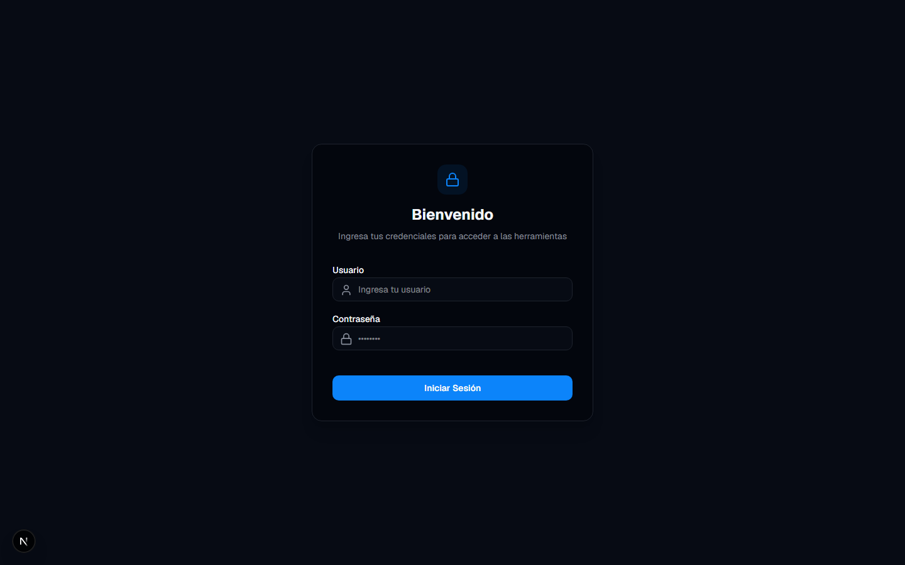

---

## Pantalla principal

A la izquierda está el menú **Herramientas**: haz clic en la opción que necesites. Abajo puedes cambiar la **Apariencia**, **Descargar manual** y **Cerrar Sesión**. Solo verás las herramientas que tu administrador te habilitó.

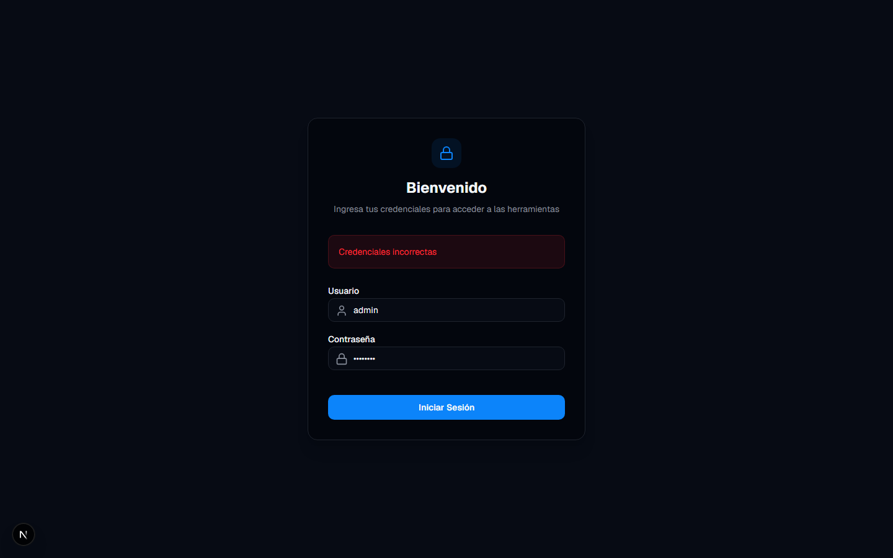

---

## Comparador de Datos

Sirve para comparar dos archivos Excel y obtener un reporte con diferencias, coincidencias o ambos.

**Proceso:** sube el Archivo Principal (tu base) y el Archivo de Contraste. Ajusta hoja, columnas o filas solo si hace falta. Elige el tipo de reporte (solo diferencias, solo coincidencias o ambos) y haz clic en **Comenzar comparación**. Se descargará un Excel nuevo; tus archivos originales no se modifican. Usa la misma columna clave en ambos (por ejemplo RUT o código).

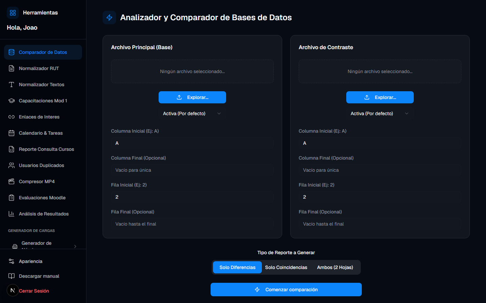

---

## Normalizador RUT

Sirve para dejar una lista de RUT chilenos con el mismo formato.

**Proceso:** pega un RUT por línea en el cuadro de la izquierda, elige el formato (con o sin puntos y guión; K en minúscula si aplica), haz clic en **Normalizar** y copia el resultado de la derecha.

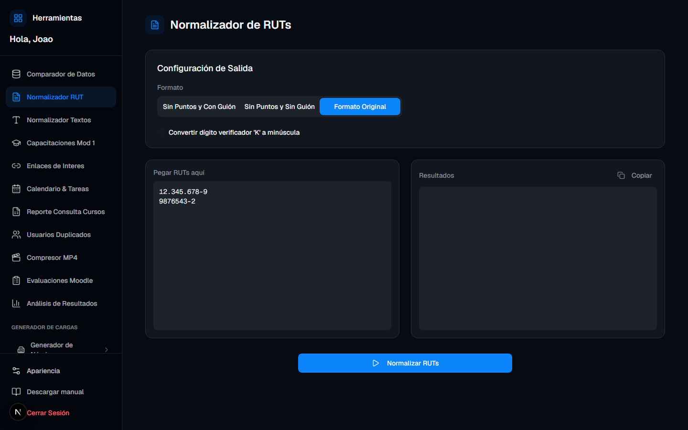

---

## Normalizador de Textos

Sirve para transformar listas de texto a MAYÚSCULAS, minúsculas o Formato Título.

**Proceso:** pega una línea por registro, elige el formato deseado, haz clic en **Normalizar** y copia el resultado.

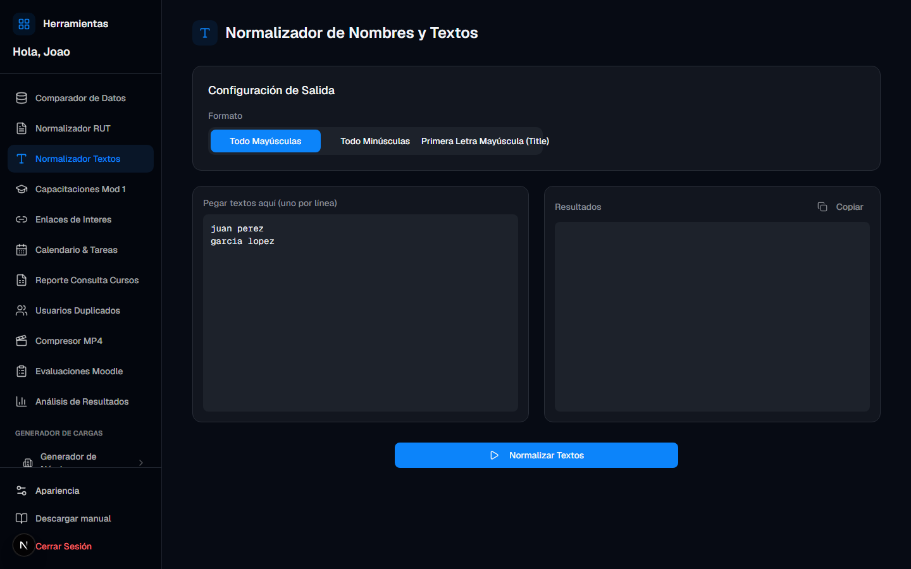

---

## Capacitaciones Mod 1

Sirve como agenda personal de capacitaciones (título, enlace, duración, notas y fecha). En general solo tú ves lo que guardas con tu usuario.

**Proceso:** revisa el listado (puedes buscar). Para agregar, usa **Nueva Capacitación**, completa al menos el título y guarda. Para quitar una, usa el icono de papelera en esa fila.

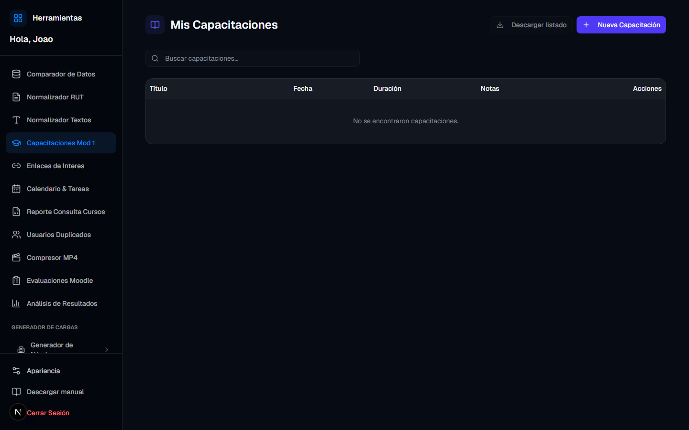

---

## Enlaces de interés

Sirve para guardar y organizar enlaces útiles por empresa.

**Proceso:** filtra por empresa o busca por texto. Para agregar, indica título, URL, empresa y notas opcionales, y guarda. Desde cada tarjeta puedes abrir el enlace, editarlo o eliminarlo.

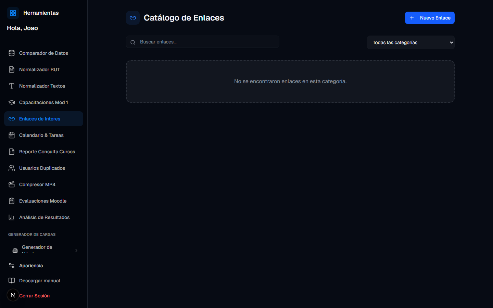

---

## Calendario y tareas

Sirve para agendar tareas por día, marcarlas como hechas e importar varias desde Excel.

**Proceso:** navega el mes con las flechas (naranja = pendientes, verde = completadas) y haz clic en un día para ver sus tareas. Para crear una, completa el título y, si aplica, curso, grupo, asunto, cuerpo de mail, correo de aviso y notas; luego guarda. Para importar, pega columnas Día y Tarea desde Excel y confirma en el asistente. El botón **Abrir Mail Composer** abre el sitio externo de BEX con los campos listos; no envía el correo desde esta plataforma.

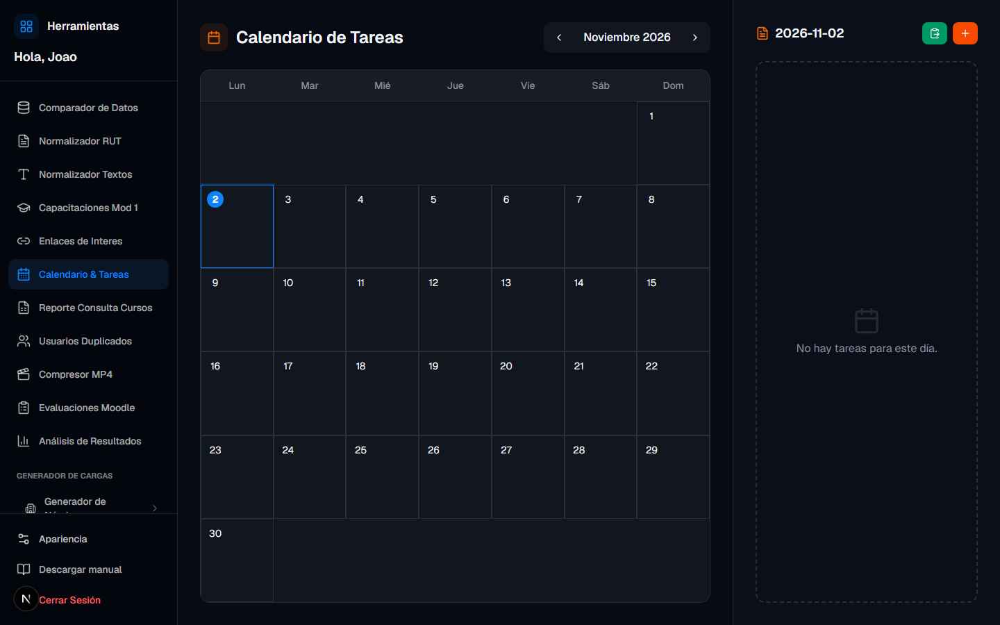

---

## Reporte Consulta Cursos

Sirve para convertir el texto de una consulta de cursos de Moodle en un Excel ordenado.

**Proceso:** pega el texto completo de la consulta, usa **Previsualizar** para revisar totales, elige si quieres varias hojas (una por curso) o una sola hoja, y descarga el Excel.

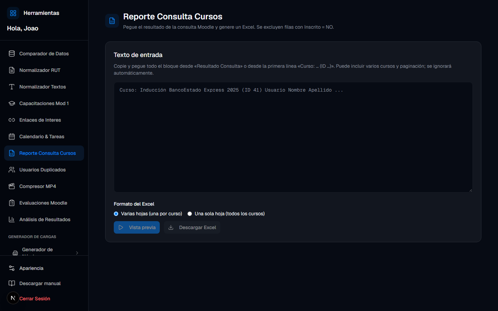

---

## Usuarios Duplicados

Sirve para analizar un Excel de nómina o usuarios y detectar grupos duplicados (por ejemplo mismo RUT o correo).

**Proceso:** sube el archivo Excel, haz clic en **Analizar**, revisa los grupos encontrados y descarga o copia los resultados. En la misma pantalla queda un historial de análisis previos.

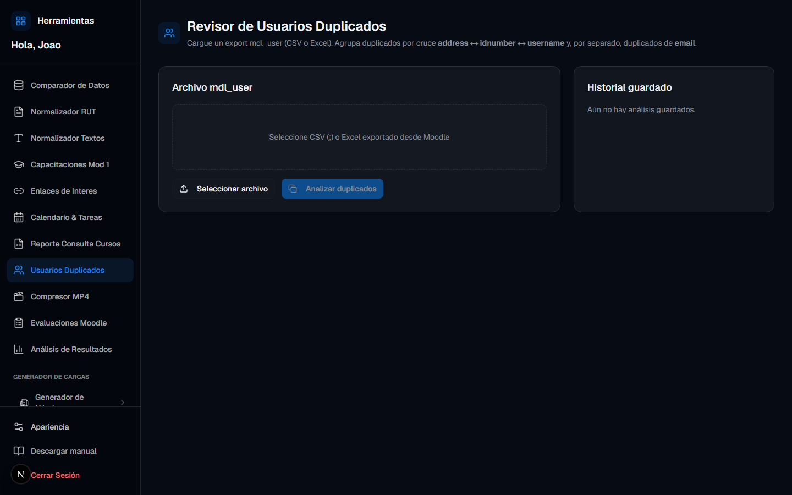

---

## Compresor MP4

Sirve para comprimir videos MP4 y generar un ZIP (reproductor + video) listo para subir a Moodle.

**Proceso:** elige resolución (720p o 480p) y calidad (**Normal** o **Más compacto**; Más compacto se recomienda para videos de una hora o más). Agrega los videos, haz clic en **Optimizar** e indica LMS e ID de curso. Cuando termine, usa **Descargar ZIP**. En servidor, usa siempre el botón de descarga de la interfaz.

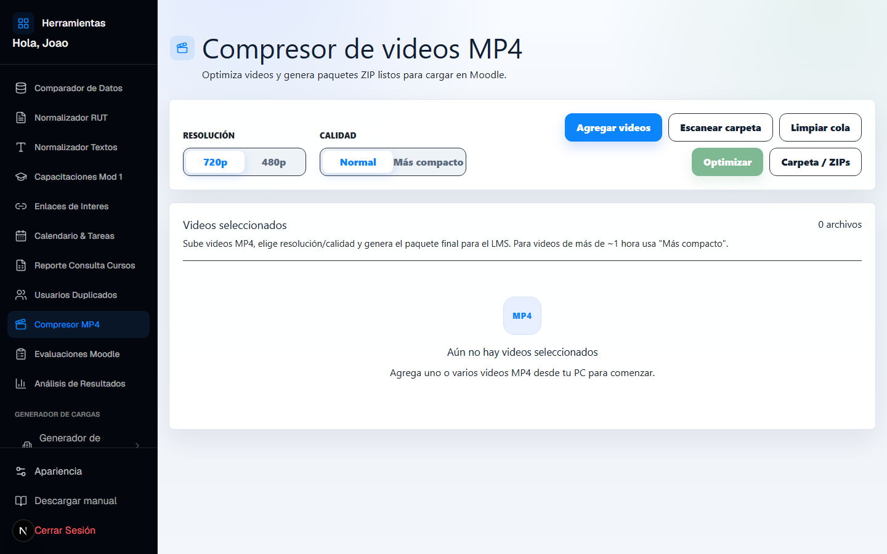

---

## Evaluaciones Moodle

Sirve para preparar evaluaciones para importar o documentar en Moodle.

**Proceso:** pega o carga el borrador (texto, GIFT `.txt` o Word `.docx`). Usa **Ordenar** para limpiar el contenido. Convierte a GIFT (con o sin negrita) para importar a Moodle, o exporta a Word. Si cargas un Word, puedes marcar la alternativa correcta y descargar el archivo modificado. Flujo habitual: pegar → ordenar → convertir a GIFT → descargar.

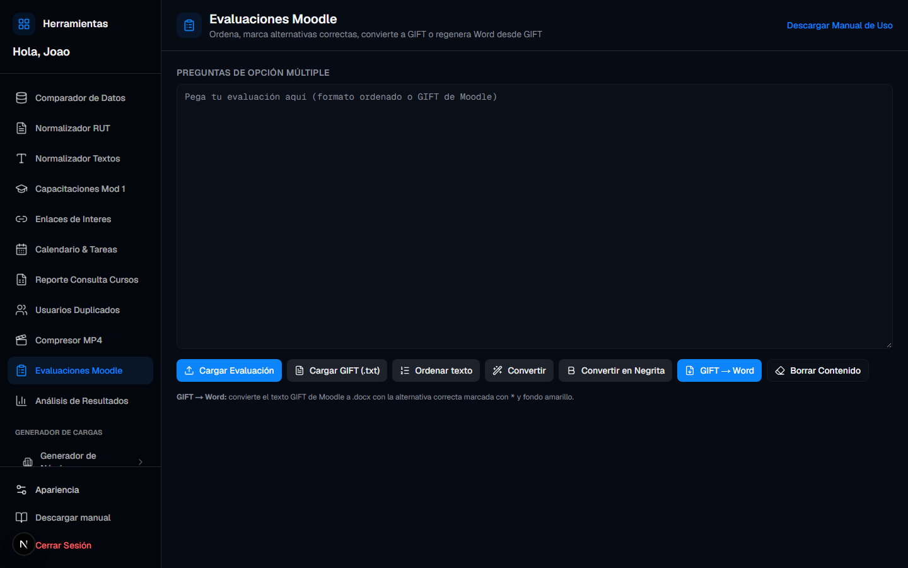

---

## Análisis de Resultados

Sirve para analizar el informe de respuestas de un quiz Moodle a partir de un solo Excel.

**Proceso:** sube el Excel exportado desde Moodle (debe traer enunciado, respuesta del usuario y respuesta correcta por pregunta). Usa **Previsualizar** para ver porcentaje de acierto y preguntas difíciles. Luego descarga el Excel con las hojas Resumen, Por pregunta, Por usuario y Detalle de respuestas. Se considera acierto si la respuesta coincide con la correcta; si alguien rindió varias veces, aparecen todos los intentos.

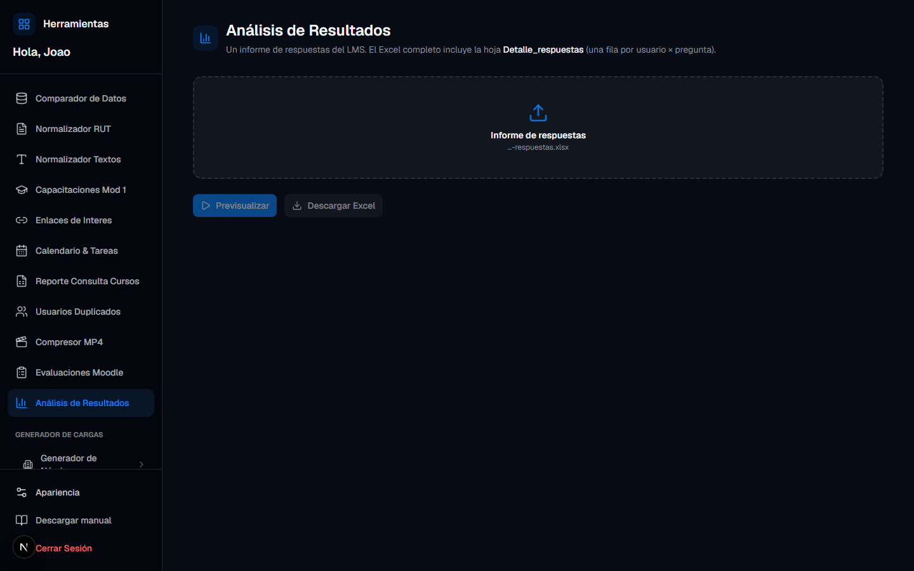

---

## Generador de Nóminas / Cargas

Sirve para generar cargas o comparaciones según el cliente. Entra a **Generador de Nóminas**, elige el cliente y el proceso.

**Proceso BEX (cargas e inducciones):** sube el Excel de dotación con títulos en la primera fila; elige hoja y columnas (puedes usar Recomendadas Moodle); mapea columnas, nombre de grupo y la columna de perfil de inducción (debe coincidir con los perfiles de la plataforma); previsualiza y genera el ZIP con un CSV por perfil para Moodle.

**Otros clientes:** Transelec (altas, externos, asignación), AZA (comparar nóminas), Resiter (CSV desde matriz SAP), Carozzi (comparar DNI/C.I., Todos Chile, separar cursos) y EMIN (comparar nóminas y consolidar cambios). Cada uno sigue un asistente similar: subir archivo, revisar opciones y descargar el resultado. Si un cliente aparece como no disponible, aún no tiene proceso activo en tu instalación.

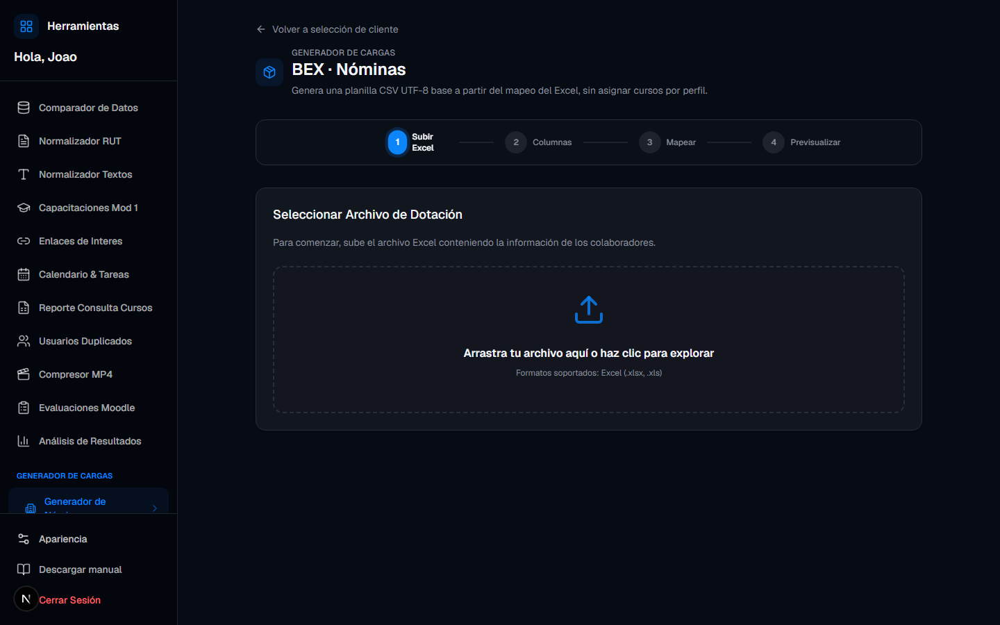

---

## Panel de Administrador

Visible solo si eres superadministrador.

**Proceso:** crea o edita usuarios, asigna solo los módulos que cada persona necesita y, según la instalación, configura el correo SMTP de recordatorios. Asigna el mínimo de permisos necesario.

---

## Ayuda

Si no ves una herramienta que necesitas, pide a tu administrador que te habilite el permiso. Para problemas de acceso (usuario, contraseña o enlace), contacta a sistemas o a quien te dio la cuenta.

Guías técnicas de servidor (Docker, credenciales TI) están fuera de este manual: ver `DEPLOY_DOCKER.md` y `PASO_A_PASO_TI.md` en el repositorio.
